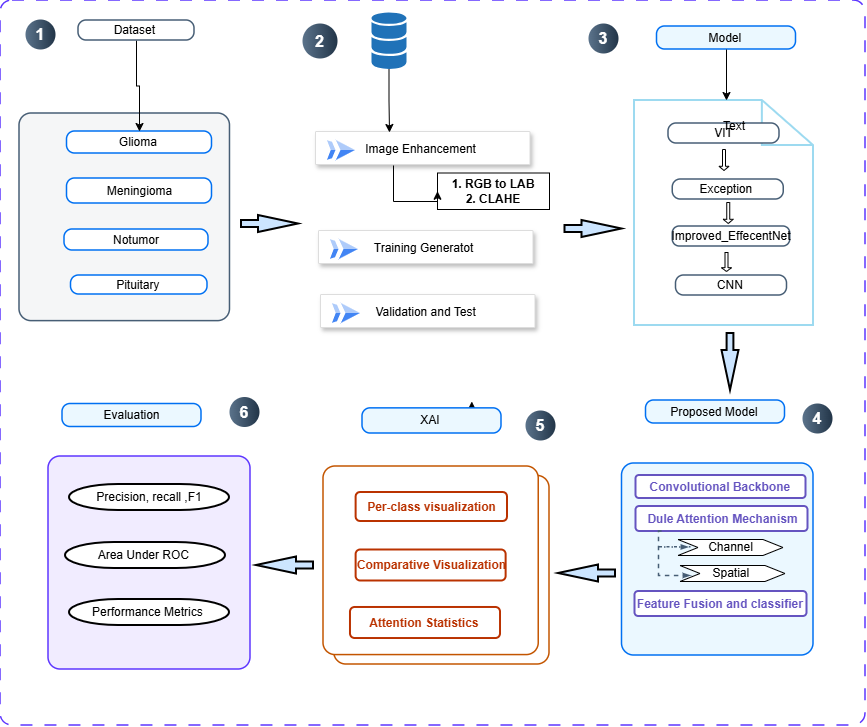
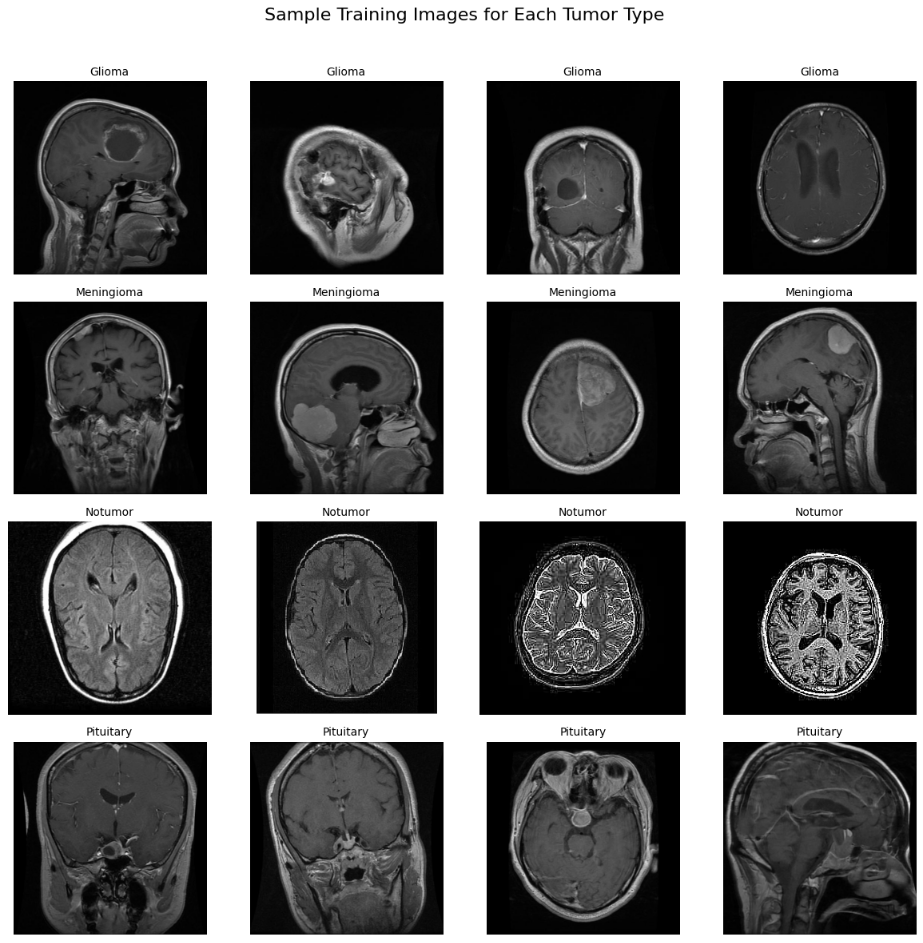
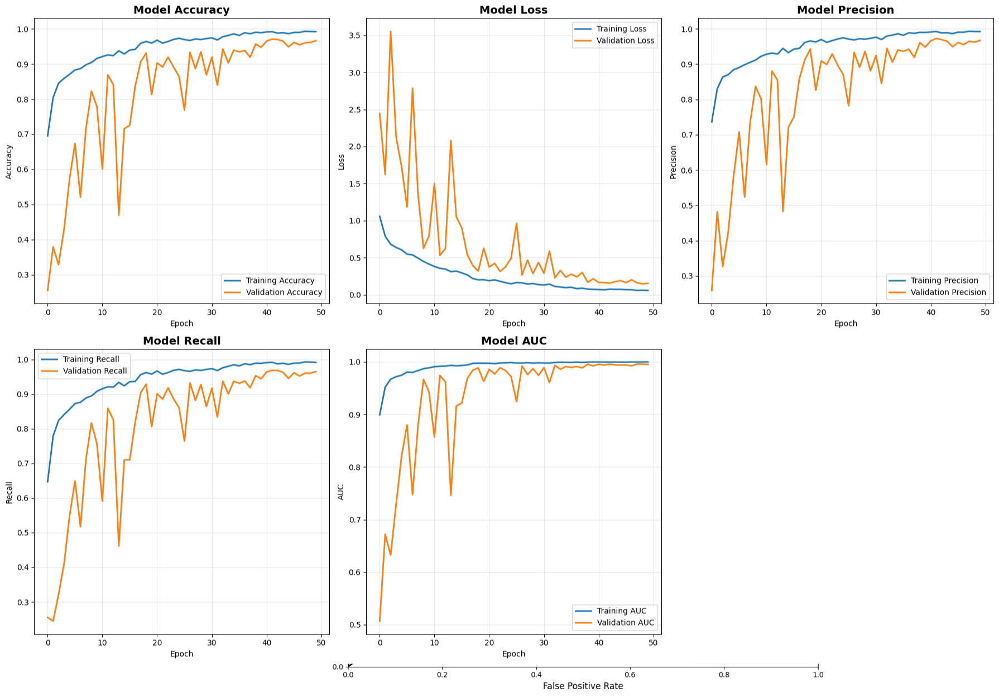
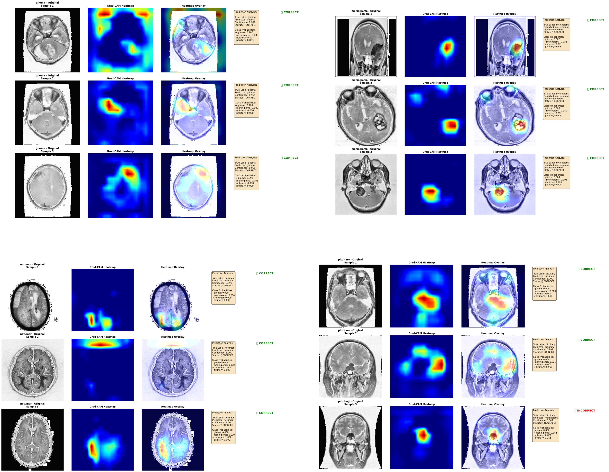

# Brain Tumor MRI Classification using Vision Transformers, Dual-Attention CNN & Explainable AI - CSE326 Project

An end-to-end medical image data mining, deep learning, and Explainable AI (Grad-CAM) classification pipeline developed in Python and TensorFlow/Keras for **CSE326 (Data Mining and Machine Learning Lab)** at Daffodil International University.



## 📌 Project Information

* **Course:** CSE326 — Data Mining and Machine Learning Lab
* **Author:** Imran Munshi (Student ID: 222-15-6376)
* **Institution:** Department of Computer Science & Engineering, Daffodil International University (DIU)
* **Dataset:** Kaggle Brain Tumor MRI Dataset (7,023 MRI scans across 4 classes: *Glioma*, *Meningioma*, *Pituitary*, and *No Tumor*)
* **Primary Notebook:** `Brain_Tumor_MRI_Classification_CSE326.ipynb`

## 🧠 Pipeline Architecture & Features

* **Data Mining & Image Enhancement:** Analyzed class distributions across 4,571 training, 1,141 validation, and 1,311 testing MRI scans, applying RGB-to-LAB color space conversion, CLAHE contrast enhancement, and real-time geometric data augmentation.
* **Custom Vision Transformer (ViT):** Built an 8-layer Vision Transformer from scratch featuring 16x16 `Conv2D` patch embeddings (196 patches, embedding dimension 256), learned positional embeddings, and 8-head Multi-Head Self-Attention blocks with GELU MLPs.
* **Transfer Learning & Fine-Tuning:** Benchmarked ImageNet-pretrained **Xception** and **EfficientNetB0** backbones using model-specific preprocessing pipelines, BatchNormalization, Dropout regularization, and top-layer unfreezing.
* **Proposed Dual-Attention CNN:** Integrated a convolutional backbone with parallel **Channel Attention** and **Spatial Attention** mechanisms to fuse local and global tumor features.
* **Explainable AI (Grad-CAM):** Generated per-class and comparative Grad-CAM activation heatmaps overlaid on brain MRI slices to visually validate clinical tumor localization.



## 📊 Experimental Results (Unseen Test Set: 1,311 Scans)

| Model Architecture | Test Accuracy (%) | Test Loss | Key Highlights |
| :--- | :---: | :---: | :--- |
| **Custom Vision Transformer (ViT)** | 81.16% | 0.4796 | 8 Transformer Encoder layers trained from scratch (19.13M parameters) |
| **Xception (Transfer Learning)** | 88.56% | 0.2930 | Strong feature extraction with 1.05M trainable head parameters |
| **Proposed Dual-Attention CNN** | **98.40%** | **0.0621** | **1,290 / 1,311 correct predictions** (100% precision/recall on *No Tumor*) |

### Confusion Matrices & Training Convergence


## 🔍 Explainable AI (Grad-CAM) Localization


## 🚀 How to Run

1. Clone this repository:
   ```bash
   git clone [https://github.com/Imran-Munshi-2022/Brain-Tumor-MRI-Classification-CSE326.git](https://github.com/Imran-Munshi-2022/Brain-Tumor-MRI-Classification-CSE326.git)
